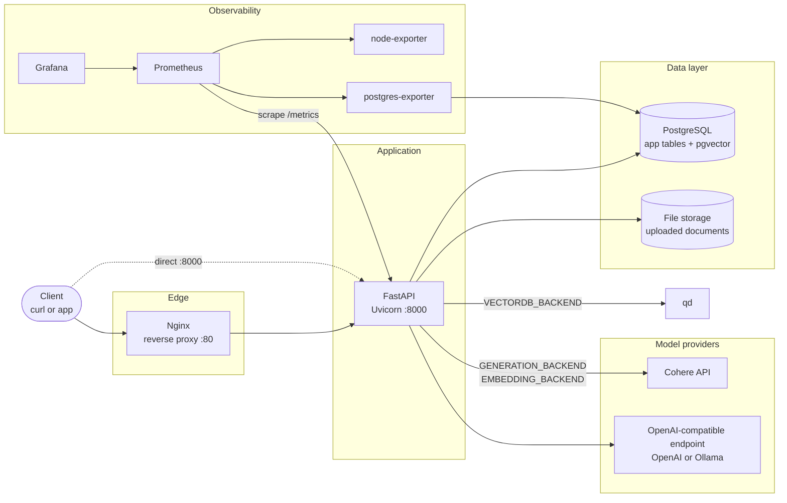
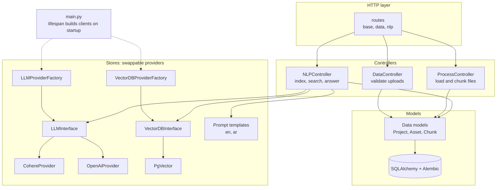
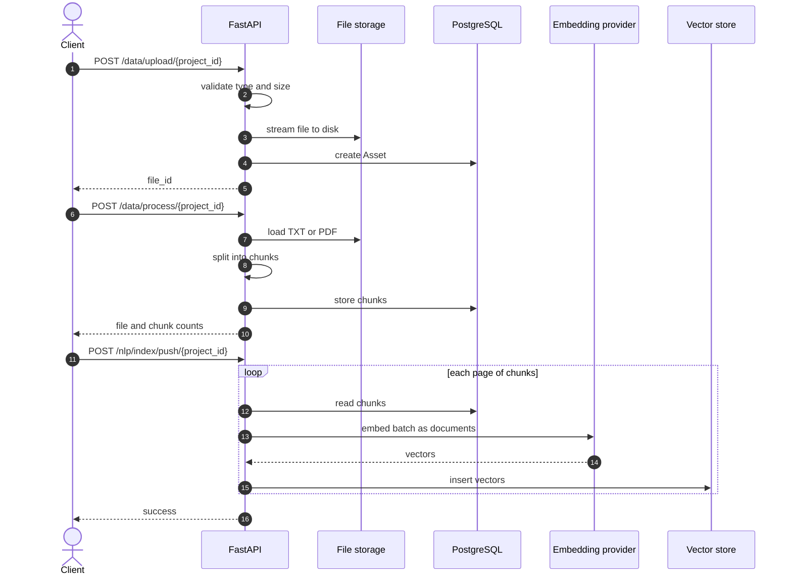
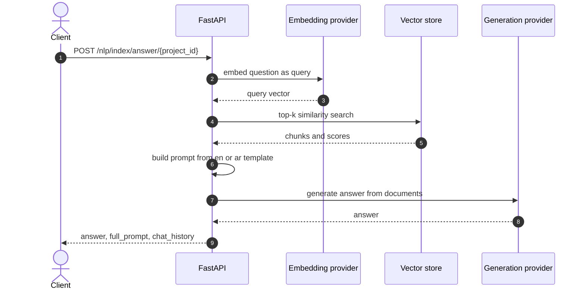
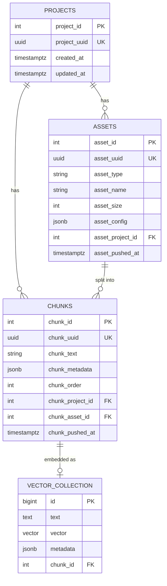
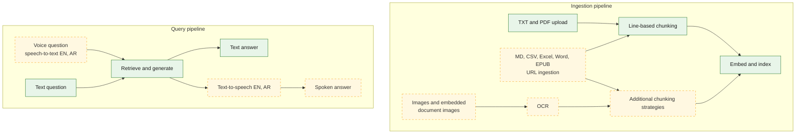

# MiniRag_26

## Tech stack

|   | Layer                    | Tools                                                                                                                                                                                                                                                                                                                                                                                                                                                                                                            |
|:--|--------------------------|------------------------------------------------------------------------------------------------------------------------------------------------------------------------------------------------------------------------------------------------------------------------------------------------------------------------------------------------------------------------------------------------------------------------------------------------------------------------------------------------------------------|
|   | **Language and tooling** |                                                                                                                                                                                                                                           |
|   | **API**                  |                                                                                                                                          |
|   | **Database and ORM**     |                                                   |
|   | **Vector search**        |                                                                                                                                                                                                                                                                                |
|   | **LLM providers**        |                                                                                                                                                                                                                             |
|   | **Document processing**  |                                                                                                                                                                                                                                |
|   | **Serving**              |                                                                                                                                                                                                                                                                                                                                                                                                                             |
|   | **Monitoring**           |      |

A production-oriented **Retrieval-Augmented Generation (RAG) backend** for question answering over your own documents, with first-class **Arabic and English** support.

Upload documents, chunk and embed them into a vector database, then search them or ask questions and get answers grounded in your content. Everything runs behind a FastAPI service with Postgres, a swappable vector store, swappable LLM providers, and built-in monitoring.

## Origin and credits

This project started as the code from the Arabic course **[mini-RAG | From notebooks to the PRODUCTION](https://www.youtube.com/playlist?list=PLvLvlVqNQGHCUR2p0b8a0QpVjDUg50wQj)** by [@bakrianoo](https://github.com/bakrianoo). Huge thanks for the excellent tutorial.

It is now being developed beyond the course: new file formats, advanced chunking, OCR, and voice (see the [Roadmap](#roadmap)).

## Features

**Available today**

- **Document ingestion:** upload `.txt` and `.pdf` files (max 10 MB, configurable)
- **Project-based isolation:** each `project_id` has its own files, chunks and vector collection
- **Chunking:** line-aware text chunking with configurable chunk size
- **Pluggable LLM providers:** Cohere and any OpenAI-compatible API (including local models via [Ollama](#using-a-local-model-with-ollama))
- **Pluggable vector stores:** PostgreSQL + pgvector
- **Semantic search** and **RAG answering** with localized prompt templates (English and Arabic)
- **Observability:** Prometheus metrics, Grafana, node-exporter and Postgres exporter included
- **Containerized:** one `docker compose` command brings up the full stack, with Alembic migrations run on startup

## Architecture

### System overview



### Code structure

Providers sit behind interfaces and factories, so LLMs and vector stores can be swapped through configuration.



### Ingestion flow



### Question answering flow



### Data model

Each project gets its own vector collection (one table when using pgvector).



### Where it is heading

Green is implemented, dashed amber is on the [Roadmap](#roadmap).



### Project layout

```text
src/
├── routes/        # HTTP endpoints (base, data, nlp)
├── controllers/   # Business logic (processing, NLP/RAG, projects)
├── models/        # SQLAlchemy models, Alembic migrations, schemas, enums
├── stores/
│   ├── llm/       # Provider interface, factory, Cohere/OpenAI providers, prompt templates (en, ar)
│   └── vectordb/  # Vector DB interface, factory, pgvector provider
├── helpers/       # Settings (pydantic-settings)
└── utils/         # Prometheus metrics middleware
docker/            # Compose stack, Dockerfile, Nginx, Prometheus config, env examples
```

## Prerequisites

**Both paths**

- An LLM provider: a [Cohere](https://cohere.com) API key, an OpenAI-compatible API key, or a local [Ollama](https://ollama.com) server

**Docker path**

- Docker Engine and Docker Compose v2

**Dev path**

- [uv](https://docs.astral.sh/uv/getting-started/installation/) (it installs the pinned Python 3.13 for you)
- PostgreSQL with the [pgvector](https://github.com/pgvector/pgvector) extension available
- Build dependencies (Debian/Ubuntu): `sudo apt update && sudo apt install libpq-dev gcc python3-dev`

## Quickstart (Docker)

The fastest way to a working API.

**1. Clone**

```bash
git clone https://github.com/ElsebaiyMohamed/MiniRag_26.git
cd MiniRag_26/docker
```

**2. Create your config files from the examples.** The repository only ships `*.example` files. Real config files contain secrets and are git-ignored, so you must create them:

```bash
cp envv/.env.example.app              envv/.env.app
cp envv/.env.example.postgres         envv/.env.postgres
cp envv/.env.example.postgresexporter envv/.env.postgresexporter
cp envv/.env.example.grafana          envv/.env.grafana
cp minirag/alembic.example.ini        minirag/alembic.ini
```

**3. Edit them.** Use the same database credentials everywhere:

| File                         | Set                                                                                                                                                                                                            |
|------------------------------|----------------------------------------------------------------------------------------------------------------------------------------------------------------------------------------------------------------|
| `envv/.env.postgres`         | `POSTGRES_USER=postgres`, `POSTGRES_PASSWORD=<password>`, `POSTGRES_DB=minirag26`                                                                                                                              |
| `envv/.env.postgresexporter` | `DATA_SOURCE_USER=postgres`, `DATA_SOURCE_PASS=<password>`                                                                                                                                                     |
| `envv/.env.app`              | `POSTGRES_USERNAME=postgres`, `POSTGRES_PASSWORD=<password>`, `POSTGRES_HOST=pgvector`, `POSTGRES_PORT=5432`, `POSTGRES_MAIN_DATABASE=minirag26`, plus your LLM settings (see [Configuration](#configuration)) |
| `envv/.env.grafana`          | Change the admin password                                                                                                                                                                                      |
| `minirag/alembic.ini`        | `sqlalchemy.url = postgresql://postgres:<password>@pgvector:5432/minirag26`                                                                                                                                    |

**4. Start the stack**

```bash
docker compose up -d --build
```

Database migrations run automatically when the `fastapi` container starts.

**5. Check it**

```bash
curl http://localhost:8000/
```

| Service              | URL                        |
|----------------------|----------------------------|
| API (direct)         | http://localhost:8000      |
| API (via Nginx)      | http://localhost           |
| Interactive API docs | http://localhost:8000/docs |
| Grafana              | http://localhost:3000      |
| Prometheus           | http://localhost:9090      |

## Local development (uv)

**1. Install dependencies** (from the repository root)

```bash
uv sync
```

**2. Create the app config from the example**

```bash
cp src/.env.example src/.env.app
```

Edit `src/.env.app` with your database and LLM settings. For a local Postgres use `POSTGRES_HOST=localhost`.

**3. Create the Alembic config from the example**

```bash
cd src/models/db_schemas/minirag26
cp alembic.ini.example alembic.ini
```

Edit `alembic.ini` and set `sqlalchemy.url` to your database, for example `postgresql://postgres:<password>@localhost:5432/minirag26`.

**4. Run the migrations** (from the same directory)

```bash
uv run alembic upgrade head
```

**5. Start the API**

```bash
cd ../../..        # back to src/
uv run uvicorn main:app --reload --host 0.0.0.0 --port 8000
```

Open http://localhost:8000/docs.

## Configuration

All settings are environment variables (`.env.app`).

| Variable                                                                                             | Description                                                         |
|------------------------------------------------------------------------------------------------------|---------------------------------------------------------------------|
| `APP_NAME`, `APP_VERSION`, `APP_DESCRIPTION`                                                         | Shown at `GET /`                                                    |
| `FILE_ALLOWED_EXTENTIONS`                                                                            | Allowed upload MIME types, e.g. `["application/pdf", "text/plain"]` |
| `FILE_MAX_SIZE_IN_MB`                                                                                | Max upload size (default example: `10`)                             |
| `FILE_DEAFAULT_CHINK_SIZE`                                                                           | Read size in bytes when streaming uploads to disk                   |
| `POSTGRES_USERNAME`, `POSTGRES_PASSWORD`, `POSTGRES_HOST`, `POSTGRES_PORT`, `POSTGRES_MAIN_DATABASE` | PostgreSQL connection                                               |
| `VECTORDB_BACKEND`                                                                                   | `PGVECTOR`                                              |
| `VECTOR_DB_DISTANCE_METRIC`                                                                          | `cosine` or `dot`                                                   |
| `VECTOR_DB_PGVEC_INDEX_THRESHOLD`                                                                    | Row count at which a pgvector index is created                      |
| `GENERATION_BACKEND`, `EMBEDDING_BACKEND`                                                            | `COHERE` or `OPENAI` (OpenAI-compatible, including Ollama)          |
| `GENERATION_MODEL_ID`, `EMBEDDING_MODEL_ID`                                                          | Model names for the chosen backends                                 |
| `EMBEDDING_MODEL_SIZE`                                                                               | Embedding dimension. Must match the embedding model                 |
| `COHERE_API_KEY`                                                                                     | Cohere key                                                          |
| `OPENAI_API_KEY`, `OPENAI_API_URL`                                                                   | Key and base URL for OpenAI or any compatible server                |
| `INPUT_DEFAULT_MAX_CHAR`, `DEAFAULT_MAX_OUTPUT_TOKENS`, `GENERATION_DEFAULT_TEMPERATURE`             | Generation defaults                                                 |
| `PRIMARY_LANG`, `DEFAULT_LANG`                                                                       | Prompt template language (`ar` or `en`) and fallback                |

> **Notes**
> - For Arabic documents, choose a **multilingual** embedding model and set `EMBEDDING_MODEL_SIZE` to match.
> - If you change the embedding model, re-index with `"do_reset": 1` so the collection is recreated with the new dimension.

## Using a local model with Ollama

Ollama exposes an OpenAI-compatible API, so you can run fully local, using the `OPENAI` backend:

```bash
ollama pull <generation-model>
ollama pull <embedding-model>
```

```ini
GENERATION_BACKEND="OPENAI"
EMBEDDING_BACKEND="OPENAI"
OPENAI_API_URL="http://localhost:11434/v1"
OPENAI_API_KEY="ollama"            # any non-empty value
GENERATION_MODEL_ID="<generation-model>"
EMBEDDING_MODEL_ID="<embedding-model>"
EMBEDDING_MODEL_SIZE=<embedding dimension>
```

When the API runs **inside Docker**, `localhost` points at the container. Use `http://host.docker.internal:11434/v1` instead (on Linux, add `extra_hosts: ["host.docker.internal:host-gateway"]` to the `fastapi` service).

## Usage

Replace `1` with any project ID.

```bash
# 1. Upload a file (.txt or .pdf)
curl -X POST http://localhost:8000/api/v1/data/upload/1 -F "file=@document.pdf"

# 2. Chunk all files in the project
curl -X POST http://localhost:8000/api/v1/data/process/1 \
  -H "Content-Type: application/json" \
  -d '{"chunk_size": 1000, "do_reset": 0}'

# 3. Embed and index the chunks
curl -X POST http://localhost:8000/api/v1/nlp/index/push/1 \
  -H "Content-Type: application/json" \
  -d '{"do_reset": 1}'

# 4a. Semantic search
curl -X POST http://localhost:8000/api/v1/nlp/index/search/1 \
  -H "Content-Type: application/json" \
  -d '{"text": "your question", "limit": 5}'

# 4b. RAG answer
curl -X POST http://localhost:8000/api/v1/nlp/index/answer/1 \
  -H "Content-Type: application/json" \
  -d '{"text": "your question", "limit": 5}'
```

| Method | Endpoint                                | Purpose                                              |
|--------|-----------------------------------------|------------------------------------------------------|
| `GET`  | `/`                                     | App info                                             |
| `GET`  | `/metrics`                              | Prometheus metrics                                   |
| `POST` | `/api/v1/data/upload/{project_id}`      | Upload a file                                        |
| `POST` | `/api/v1/data/process/{project_id}`     | Chunk the project's files (`chunk_size`, `do_reset`) |
| `POST` | `/api/v1/nlp/index/push/{project_id}`   | Embed chunks and store vectors (`do_reset`)          |
| `GET`  | `/api/v1/nlp/index/info/{project_id}`   | Vector collection info                               |
| `POST` | `/api/v1/nlp/index/search/{project_id}` | Semantic search (`text`, `limit`)                    |
| `POST` | `/api/v1/nlp/index/answer/{project_id}` | RAG answer (`text`, `limit`)                         |

## Roadmap

| Area             | Planned                                                           | Status  |
|------------------|-------------------------------------------------------------------|---------|
| **File formats** | Markdown, CSV, Excel, Word, EPUB                                  | Planned |
|                  | Ingest content from a URL / link                                  | Planned |
| **Chunking**     | Additional chunking strategies, benchmarked for retrieval quality | Planned |
| **Vision**       | Image input                                                       | Planned |
|                  | Extract images from documents                                     | Planned |
|                  | OCR                                                               | Planned |
| **Voice**        | Voice input (speech-to-text), English and Arabic                  | Planned |
|                  | Spoken answers (text-to-speech), English and Arabic               | Planned |
| **Quality**      | Tests, CI, API authentication                                     | Planned |

## Known limitations

- Only `.txt` and `.pdf` are supported; uploads are validated by MIME type.
- No authentication. Don't expose the service to the public internet as-is.
- `overlap_size` is accepted by the process endpoint but not applied yet.

## Contributing

Issues and ideas are welcome. Please open an issue to discuss larger changes before sending a pull request.

## License

[Apache License 2.0](LICENSE)
